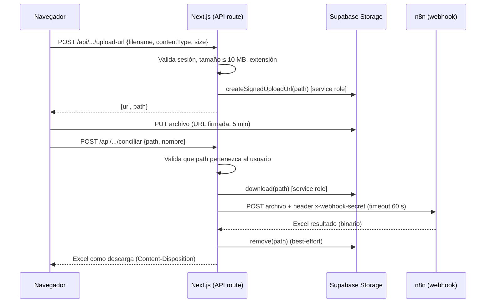

# Arquitectura general del portal Toolbox

> Portal interno del equipo contable de Siigo para operar automatizaciones (n8n) y vistas de datos contables (Supabase). Esta guía describe lo que es común a todos los procesos. Cada proceso tiene su propio documento.

## 1. Stack

| Capa | Tecnología |
|---|---|
| Framework | Next.js 16 (App Router, `src/`, TypeScript estricto) |
| UI | Tailwind CSS v4, shadcn/ui (Radix + Base UI), lucide-react, next-themes, sonner (toasts), TanStack Table |
| Formularios / validación | react-hook-form, zod |
| Estado cliente | React state, zustand |
| Auth, BD, Storage | Supabase (`@supabase/ssr`, `@supabase/supabase-js`) |
| Orquestación | n8n (solo accesible desde el servidor) |
| Excel | `xlsx` (lectura), `xlsx-populate` (reescritura con estilos), escritor propio (`comisiones/xlsx-writer.ts`) |
| Scripts | `tsx` (`scripts/`) |
| Tests | Playwright (solo existe `tests/example.spec.ts`) |

Entorno de desarrollo previsto: **WSL (Ubuntu 22.04+) con Node 22.18+**. Node desde Windows da problemas de rutas UNC con Turbopack.

## 2. Estructura del repositorio

```
src/
├── app/
│   ├── (auth)/login/                 Login
│   ├── (app)/                        Rutas protegidas (sidebar + topbar)
│   │   ├── dashboard/                Catálogo de procesos visibles por rol
│   │   ├── conciliaciones/{colombia,uruguay,ecuador}/
│   │   ├── ingresos/{calculo-comisiones,gestion-anticipos,notas-credito}/
│   │   ├── admin/usuarios/
│   │   └── [area]/[proceso]/         Placeholder para procesos sin página propia
│   ├── api/
│   │   ├── conciliaciones/{upload-url,conciliar}/
│   │   └── notas-credito/{upload-url,conciliar}/
│   └── layout.tsx
├── components/                       UI por proceso + ui/ (shadcn) + layout/
├── lib/
│   ├── auth/                         Login/logout, roles
│   ├── admin/users.ts                Gestión de usuarios y roles
│   ├── supabase/{server,client,admin}.ts
│   ├── conciliaciones/ notas-credito/ comisiones/ anticipos/ retirados/
│   ├── n8n.ts                        Cliente HTTP genérico hacia n8n
│   ├── env.ts                        Validación zod de variables de entorno
│   ├── navigation.ts                 Catálogo de áreas y procesos
│   └── uploads.ts                    Constantes de subida (extensiones, 10 MB)
├── proxy.ts                          Protección de rutas + refresh de sesión (Next 16)
└── types/supabase.ts                 Tipos generados de la BD
scripts/                              CLI: import-retirados, match-retirado
supabase/migrations/                  Migraciones SQL (ver "Base de datos: un schema por proceso")
```

## 3. Mapa de procesos

Áreas del menú (`src/lib/navigation.ts`): **Conciliaciones**, **Ingresos y egresos** (`/ingresos-egresos/…`) y **Reportes** (`/reportes/…`). Las rutas anteriores `/ingresos/…` y `/egresos/…` redirigen a las nuevas (`next.config.ts`). Los ids de proceso no se renombraron al mover áreas (`ingresos.export-bancos` vive en Reportes): son la llave de `core.permisos` y de RLS; el área solo se refleja en la columna informativa `core.procesos.area`.

| Proceso | Ruta | Rol requerido | n8n | Tablas / buckets Supabase | Doc |
|---|---|---|---|---|---|
| Conciliación Colombia / Uruguay / Ecuador | `/conciliaciones/{colombia,uruguay,ecuador}` | `conciliaciones` + país | Sí (webhook por banco) | `conciliaciones.bancos`, bucket `conciliaciones-uploads` | [02](02-conciliaciones.md) |
| Conciliación Chile / México | `/conciliaciones/{chile,mexico}` | `conciliaciones` + país | No (placeholder) | — | [02](02-conciliaciones.md) |
| Notas crédito | `/ingresos-egresos/notas-credito` | `ingresos` | Sí (webhook fijo) | bucket `notas-credito-uploads` | [03](03-notas-credito.md) |
| Cálculo de comisiones | `/ingresos-egresos/calculo-comisiones` | `ingresos` | No | `comisiones.*` (6 tablas + RPC) | [04](04-calculo-comisiones.md) |
| Gestión y legalización de anticipos | `/ingresos-egresos/gestion-anticipos` | `ingresos` | No | `anticipos.registros`, `anticipos.retirados` | [05](05-gestion-anticipos.md) |
| Importación de excolaboradores | Sheet dentro de anticipos + CLI | `ingresos` o `admin` | No | `anticipos.retirados`, `anticipos.retirados_imports` | [06](06-importacion-retirados.md) |
| Servicios públicos | `/ingresos-egresos/servicios-publicos` | `egresos.servicios-publicos` | No | `servicios_publicos.*`, bucket `servicios-publicos-soportes` | [07](07-servicios-publicos.md) |
| Autenticación, permisos y usuarios | `/login`, `/admin/usuarios` | admin (usuarios) | No | `core.procesos`, `core.permisos`, `core.usuarios`, `auth.users` | [01](01-autenticacion-y-roles.md) |

## 4. Variables de entorno

Plantilla en `.env.example`; se copia a `.env.local`. Validadas en `src/lib/env.ts` con zod.

| Variable | Alcance | Uso |
|---|---|---|
| `NEXT_PUBLIC_SUPABASE_URL` | Pública | URL del proyecto Supabase. Obligatoria. |
| `NEXT_PUBLIC_SUPABASE_ANON_KEY` | Pública | Anon/publishable key. Obligatoria. |
| `SUPABASE_SERVICE_ROLE_KEY` | Servidor | Cliente admin: URLs firmadas de subida, lectura/borrado de buckets, roles, import de retirados. **Nunca al cliente.** |
| `N8N_BASE_URL` | Servidor | URL base de n8n. |
| `N8N_WEBHOOK_SECRET` | Servidor | Secreto compartido; se envía en el header `x-webhook-secret`. |
| `N8N_NOTAS_CREDITO_PATH` | Servidor | Ruta del webhook de notas crédito. Por defecto `webhook/conciliacion-netsuite`. |

> Los webhooks de las conciliaciones **no** usan variable de entorno: la URL completa vive por banco en la tabla `conciliaciones.bancos.webhook_url`.

### Base de datos: un schema por proceso

`public` queda vacío. Cada proceso tiene su schema y las tablas van sin prefijo (el schema ya dice de qué son):

| Schema | Contenido |
|---|---|
| `core` | `procesos`, `permisos`, `usuarios`, `user_activity`, RPC `touch_last_seen`; `guardar_permisos` y `storage_archivos_vencidos` (solo service role) |
| `conciliaciones` | `bancos` |
| `anticipos` | `registros`, `retirados`, `retirados_imports`, enums `falta` / `observacion_1`, RPC `match_colaborador_retirado(_batch)`; el cruce se guarda en `registros` por triggers |
| `comisiones` | `conceptos`, `periodo_valores`, `bases`, `reconocimientos`, `gasto_registrado`, `cierres`, RPC `guardar_cierre` |
| `export_bancos` | `campos`, `campo_valores`, `plantillas` |
| `servicios_publicos` | `servicios`, `recibos`, `recibos_historial`, RPC `preparar_mes` |
| `private` | Helpers de RLS/triggers (`tiene_acceso`, `set_updated_at`, `normalize_colaborador_name*`). **No se expone** en la Data API |

Desde código: `supabase.schema("comisiones").from("conceptos")`.

**Agregar un proceso nuevo**:

1. Migración con `create schema <proceso>;` y las tablas dentro. Copiar el bloque de privilegios de `20261029120000_schemas_por_proceso.sql` (usage + default privileges para `authenticated`/`service_role`, nunca `anon`).
2. Registrar el proceso en `core.procesos` y en `PROCESOS` (`src/lib/auth/permisos-shared.ts`); habilitar RLS con `private.tiene_acceso('<area>.<proceso>', 'ver' | 'usar')`. Ver [01](01-autenticacion-y-roles.md#agregar-un-proceso).
3. Agregar el schema en Supabase › Project Settings › Data API › **Exposed schemas**.
4. Regenerar `src/types/supabase.ts` incluyendo el schema nuevo.

**Storage**: los buckets de trabajo son temporales; la excepción es `servicios-publicos-soportes` (soportes de pago, permanentes y fuera de la limpieza). `/api/cron/limpiar-storage` (Vercel Cron diario, `CRON_SECRET`) borra lo que tenga más de 1 día en `conciliaciones-uploads`, `notas-credito-uploads` y `exports`. Los borrados se hacen con la Storage API; Supabase bloquea `delete from storage.objects`.

## 5. Tres clientes de Supabase

| Archivo | Credencial | Dónde se usa | RLS |
|---|---|---|---|
| `lib/supabase/server.ts` | anon key + cookies de sesión | Server Components, Server Actions, Route Handlers | Aplica con el usuario logueado |
| `lib/supabase/client.ts` | anon key | Navegador | Aplica |
| `lib/supabase/admin.ts` | **service role** (singleton cacheado) | Solo servidor: signed URLs, Storage, lectura de permisos, import de retirados | Se salta RLS |

## 6. Patrón común: subir archivo y ejecutar un flujo n8n

Tanto conciliaciones como notas crédito evitan enviar el archivo por el servidor de Next (límite de tamaño de body en Vercel). Usan **subida directa a Supabase Storage con URL firmada**.



Reglas compartidas (`src/lib/uploads.ts`):

- Extensiones: `.xlsx`, `.xls`, `.csv`. MIME aceptados: Excel, CSV y `application/octet-stream`. La validación pasa si **MIME o extensión** son válidos.
- Tamaño máximo: **10 MB**.
- Estados del archivo en UI: `idle → uploading → processing → done | error`.
- El resultado se mantiene en memoria del navegador (`Blob` + `URL.createObjectURL`); **no se guarda historial en servidor**.

## 7. Cliente n8n genérico (`lib/n8n.ts`)

`n8nRequest(path, {method, query, body, timeoutMs})` construye la URL desde `N8N_BASE_URL`, añade `x-webhook-secret`, aplica timeout (15 s por defecto) y lanza `N8nError` con códigos 502 (red) y 504 (timeout).

> **Hoy ningún proceso lo usa.** Conciliaciones y notas crédito hacen su propio `fetch` con `FormData`/`File`. Está listo para la fase de "catálogo de automatizaciones" prevista en el README.

## 8. Seguridad

- `N8N_WEBHOOK_SECRET` y `SERVICE_ROLE_KEY` solo existen en el servidor.
- Sesión en cookies `httpOnly` administradas por `@supabase/ssr`.
- `proxy.ts` valida el JWT con `getClaims()` en cada request y redirige a `/login` si no hay sesión.
- Las API de subida/conciliación comprueban que el `path` de Storage empiece por el id del usuario, para que nadie procese archivos ajenos.

## 9. Lo que NO está en este repositorio

| Elemento | Dónde vive | Impacto en la documentación |
|---|---|---|
| Workflows de n8n (lógica real de conciliación por banco y de notas crédito) | Servidor n8n | Aquí solo se documenta el **contrato** (entrada/salida). Para documentar los pasos internos hay que exportar los JSON de los workflows. |
| Migraciones originales de `anticipos.registros`, `conciliaciones.bancos` y buckets/policies de Storage | Supabase (creadas fuera del repo; desde `20261029120000` todo se versiona aquí) | Esquema inferido de `types/supabase.ts`. Conviene versionarlas. |
| Reglas RLS de anticipos y conciliaciones | Supabase | No verificables desde el código. |

## 10. Hallazgos transversales

1. **README desactualizado**: describe rutas `automations`, `executions`, `settings` y "Fase 1 — scaffold" que ya no existen.
2. ~~Autorización inconsistente~~ y 3. ~~APIs que solo validaban sesión~~: **resueltos** con la capa de acceso (`src/lib/auth/acceso.ts`) y `npm run lint` (`check:acceso`). Ver [01](01-autenticacion-y-roles.md#capa-de-acceso-el-unico-guard).
4. **Migraciones incompletas** en `supabase/migrations/` (ver sección 9).
5. **Cobertura de pruebas**: solo un spec de ejemplo de Playwright.
