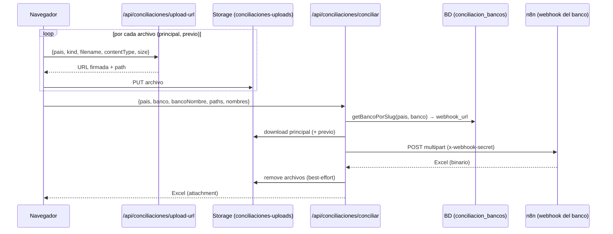

# Conciliaciones bancarias por país

## Qué hace

Permite al equipo contable **conciliar el extracto bancario de un período** (y opcionalmente el reporte previo) para un banco de un país. El portal no concilia nada por sí mismo: sube los archivos, ejecuta el **workflow de n8n configurado para ese banco** y entrega al usuario el Excel que n8n devuelve.

| País | Ruta | Estado |
|---|---|---|
| Colombia (`CO`) | `/conciliaciones/colombia` | Implementado |
| Uruguay (`UY`) | `/conciliaciones/uruguay` | Implementado |
| Ecuador (`EC`) | `/conciliaciones/ecuador` | Implementado |
| Chile (`CL`) | `/conciliaciones/chile` | Solo placeholder |
| México (`MX`) | `/conciliaciones/mexico` | Implementado (particularidades por banco) |

Las páginas implementadas usan el mismo componente `ConciliacionesPageClient`. Algunos bancos tienen **particularidades** que agregan pasos a la UI (ver más abajo).

## Acceso

Rol `conciliaciones` **con el país asignado**, o `admin`. La página llama a `requireProcesoAccess` y devuelve 404 si no hay acceso.

## Flujo del usuario

1. Elige el **banco** (combobox; lista desde BD, solo bancos activos del país). Cambiar de banco limpia el resultado.
2. Sube el **Extracto bancario** (obligatorio) y, si la tiene, la **Conciliación anterior (Excel de contadores)** (opcional). El extracto acepta `.xlsx`, `.xls`, `.csv`; la conciliación anterior solo `.xlsx` (se valida al elegirla y antes de enviar). Máx. 10 MB c/u.
3. Pulsa **Procesar conciliación**. Se ve el estado "Procesando…".
4. Al terminar, aparece **Descargar** con el Excel resultante. Se puede cancelar quitando el archivo o el banco (aborta las peticiones en curso).

## Flujo técnico

### Paso 1 — `POST /api/conciliaciones/upload-url`

Archivo: `src/app/api/conciliaciones/upload-url/route.ts`

- Requiere sesión (`getClaims`). Valida el cuerpo: `pais`, `kind` (`principal` | `previo`), `filename`, `contentType`, `size`.
- Rechaza tamaño > 10 MB (413) y tipo no soportado (415). Para `kind = previo` solo admite `.xlsx`.
- Genera la ruta `{userId_saneado}/{kind}/{uuid}.{ext}` en el bucket **`conciliaciones-uploads`** y pide una URL firmada con el cliente admin. Devuelve `{url, path, token, bucket, expiresIn: 300}`.

### Paso 2 — Subida directa

El navegador hace `PUT` del archivo a la URL firmada (no pasa por Next).

### Paso 3 — `POST /api/conciliaciones/conciliar`

Archivos: `src/app/api/conciliaciones/conciliar/route.ts`, `src/lib/conciliaciones/conciliar.ts`, `src/lib/conciliaciones/bancos.ts`

1. Valida sesión y cuerpo. `maxDuration = 90` s.
2. Comprueba que `storagePathPrincipal` (y `storagePathPrevio`) empiecen por `{userId}/principal/` o `{userId}/previo/` y no contengan más `/`. Si no: 403 `storage_unauthorized`. Si hay previo y su nombre original no es `.xlsx`: 415 `invalid_type`.
3. Busca el banco (`getBancoPorSlug`) en `conciliaciones.bancos` por `pais` + `slug`. Si no existe o `activo = false`: 400 `upstream_config`.
4. `conciliarColombia(...)` (nombre histórico; sirve a todos los países):
   - Descarga cada archivo del bucket con el cliente admin y los **revalida** (no vacío, ≤ 10 MB, tipo).
   - Arma `FormData` y hace `POST` al `webhook_url` del banco con header `x-webhook-secret` y timeout de **60 s**.
5. Devuelve el binario con `Content-Disposition: attachment` (nombre tomado de la cabecera de n8n; si no viene: `resultado_conciliacion.xlsx`) y `Cache-Control: no-store`. Reenvía `X-Registros-Nuevos` y `X-Registros-Existentes` si n8n los envía; la UI los muestra junto al botón de descarga.
6. Limpia los archivos del bucket (también cuando hay error de conciliación).

## Contrato con n8n

**Request** (`multipart/form-data`), método `POST`, header `x-webhook-secret: <N8N_WEBHOOK_SECRET>`:

| Campo | Tipo | Descripción |
|---|---|---|
| `pais` | texto | `CO`, `UY`, `EC`… |
| `banco` | texto | slug del banco (`conciliacion_bancos.slug`) |
| `bancoNombre` | texto | nombre visible |
| `file` | archivo | extracto bancario (obligatorio) |
| `previous` | archivo | conciliación anterior de los contadores, `.xlsx` (opcional; solo si se subió) |

**Response esperada:** archivo binario (por defecto Excel `.xlsx`), con headers opcionales `X-Registros-Nuevos` y `X-Registros-Existentes` (enteros). Cualquier estado no 2xx, respuesta vacía, timeout o fallo de red se traduce a error.

> Todos los bancos apuntan al mismo webhook (`/webhook/reconciliation`). **n8n elige el adapter del banco según el campo `banco` (slug)**, por configuración en n8n; la lógica de conciliación vive allí, no en este repo. Un banco nuevo solo necesita su fila en `conciliaciones.bancos` con un slug que coincida con su adapter.

## Datos

Tabla `conciliaciones.bancos` (esquema desde `types/supabase.ts`):

| Columna | Descripción |
|---|---|
| `id` | UUID |
| `pais` | `CO`, `UY`, `EC`, … |
| `slug` | Identificador del banco dentro del país |
| `nombre` | Nombre visible |
| `descripcion` | Texto bajo el combobox |
| `webhook_url` | **URL completa del webhook n8n** de ese banco |
| `es_particular` | Marca el banco como caso particular; la UI muestra una insignia |
| `activo` | Si está habilitado |
| `orden` | Orden de aparición |

Lectura de la lista (`getBancosPorPais`): cliente admin, solo activos, ordenados por `orden` y `nombre`, **sin exponer `webhook_url`**, cacheada 60 s (`conciliacion-bancos`).

### Cómo agregar o cambiar un banco

Insertar o editar una fila en `conciliaciones.bancos` (`pais`, `slug`, `nombre`, `webhook_url`, `activo = true`, `orden`). No requiere despliegue; aparece en la UI en ≤ 60 s por la caché. Para desactivarlo: `activo = false`.

## Particularidades por banco

Se declaran en `src/lib/conciliaciones/particularidades.ts` (clave `PAIS:slug`).

### Conversión TXT → Excel (México · Banorte)

Banorte entrega el extracto en uno o varios `.txt`. Con el banco `bananorte-mexico`, dentro de **Archivos a conciliar** aparece una línea discreta: "¿El extracto viene en uno o varios .txt? Convertir a Excel" (opcional). La conciliación queda en dos pasos:

1. **Paso 1 — conversión.** El usuario elige uno o varios `.txt` (input `multiple`; hasta 31 archivos y 4 MB en total, porque van directo en el cuerpo, sin Storage). `POST /api/conciliaciones/convertir-txt` (multipart: `pais`, `banco`, `files[]`) los reenvía a `/webhook/banorte-txt-a-excel` como `file_0`, `file_1`, … con `x-webhook-secret`; timeout 120 s.
   - **OK:** n8n devuelve un `.xlsx` consolidado y los headers `X-Archivos`, `X-Registros`, `X-Total-Neto`, `X-Alertas`, `X-Errores`, `X-Duplicados-Omitidos` y `X-Archivos-Error` (`[{archivo, error}]` con `encodeURIComponent`). La ruta los reenvía y la UI muestra el resumen y la lista de TXT que no se pudieron leer. El Excel se carga como **Extracto bancario** con el nombre `banorte_extracto.xlsx` y se puede descargar.
   - **Error:** el cuerpo es JSON `{ error, archivosConError[] }`; la UI muestra "Falló el paso 1 (conversión de TXT)" con el detalle por archivo.
2. **Paso 2 — conciliación.** Es el flujo normal (**Procesar conciliación** → `/webhook/reconciliation` con `banco=bananorte-mexico`, `file=banorte_extracto.xlsx` y `previous` si se subió). El botón muestra "Paso 2 de 2 · Conciliando…" y, si falla, "Falló el paso 2 (conciliación)". Timeout de 280 s (la función tiene `maxDuration = 300`).

La configuración está en `src/lib/conciliaciones/particularidades.ts` (bancos con TXT y nombre del Excel) y la URL del webhook en `src/lib/conciliaciones/convertir-txt.ts` (solo servidor).

## Errores

| Código | HTTP | Mensaje al usuario |
|---|---|---|
| `unauthorized` | 401 | Tu sesión expiró |
| `bad_request` / `missing_file` | 400 | Solicitud inválida / falta el archivo principal |
| `invalid_type` | 415 | Usa .xlsx, .xls o .csv |
| `file_too_large` | 413 | Supera 10 MB |
| `storage_unauthorized` | 403 | No tienes acceso a este archivo |
| `storage_not_found` | 404 | El archivo ya no está disponible, súbelo de nuevo |
| `upstream_config` | 400/500 | Banco sin regla/webhook configurado |
| `upstream_timeout` | 504 | La conciliación tardó demasiado |
| `upstream_network` | 502 | No se pudo contactar a n8n |
| `upstream_status` | = estado de n8n | n8n devolvió error (≥ 500: "servicio no disponible") |
| `upstream_empty` | 502 | n8n devolvió un archivo vacío |
| `internal` | 500 | Error inesperado |

## Archivos fuente

- Páginas: `src/app/(app)/conciliaciones/{colombia,uruguay,ecuador,mexico}/page.tsx`
- UI: `src/components/conciliaciones/` (`conciliaciones-page`, `bank-combobox`, `dual-upload-card`, `file-slot`, `txt-convert-row`, `types`)
- API: `src/app/api/conciliaciones/{upload-url,conciliar,convertir-txt}/route.ts`
- Lógica: `src/lib/conciliaciones/{conciliar,bancos,particularidades,convertir-txt}.ts`

## Hallazgos

1. **Autorización solo en la página**: las dos API validan sesión pero no que el usuario tenga el rol/país. Alguien autenticado podría llamar `/api/conciliaciones/conciliar` para un país que no tiene asignado.
2. `pais` no se valida contra la lista de países conocidos.
3. Nombre `conciliarColombia` confuso: es genérico.
4. No hay historial de conciliaciones; el resultado se pierde al recargar.
5. Chile está en el menú pero sin implementación.
6. La caché de bancos no se invalida manualmente (no hay `revalidateTag("conciliacion-bancos")`); depende del TTL de 60 s.
