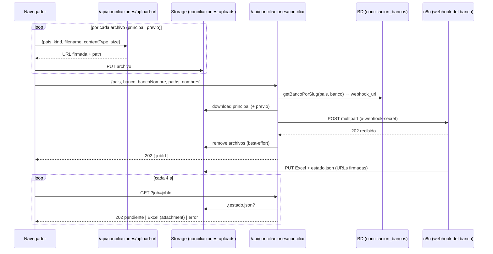

# Conciliaciones bancarias por país

## Qué hace

Permite al equipo contable **conciliar el extracto bancario de un período** (y opcionalmente el reporte previo) para un banco de un país. El portal no concilia nada por sí mismo: sube los archivos, ejecuta el **workflow de n8n configurado para ese banco** y entrega al usuario el Excel que n8n devuelve.

| País | Ruta | Estado |
|---|---|---|
| Colombia (`CO`) | `/conciliaciones/colombia` | Implementado |
| Uruguay (`UY`) | `/conciliaciones/uruguay` | Implementado |
| Ecuador (`EC`) | `/conciliaciones/ecuador` | Implementado |
| Chile (`CL`) | `/conciliaciones/chile` | Solo placeholder |
| México (`MX`) | `/conciliaciones/mexico` | Implementado (particularidades por banco) |

Las páginas implementadas usan el mismo componente `ConciliacionesPageClient`. Algunos bancos tienen **particularidades** que agregan pasos a la UI (ver más abajo).

Fuera de los países está la **conciliación de asientos de diario vs balance** (`/conciliaciones/asientos-diario`), con su propio flujo: ver [Asientos de diario](#asientos-de-diario).

## Acceso

Un proceso por país (`conciliaciones.colombia`, `conciliaciones.mexico`…). La página llama a `requireAcceso` y devuelve 404 sin acceso; las tres APIs (`upload-url`, `conciliar`, `convertir-txt`) resuelven el proceso con el `pais` del body y exigen nivel `usar`. Con `ver` se ven los bancos pero el botón de procesar queda deshabilitado.

## Flujo del usuario

1. Elige el **banco** (combobox; lista desde BD, solo bancos activos del país). Cambiar de banco limpia el resultado. Debajo aparece el **periodo vigente** del banco ("Conciliando noviembre 2026 hasta el 3 de diciembre") y, con nivel `usar`, el botón **Cambiar periodo** (ver [Periodo por banco](#periodo-por-banco)).
2. Sube el **Extracto bancario** (obligatorio) y, si la tiene, la **Conciliación anterior (Excel de contadores)** (opcional). El extracto acepta `.xlsx`, `.xls`, `.csv`; la conciliación anterior solo `.xlsx` (se valida al elegirla y antes de enviar). Máx. 10 MB c/u.
3. Pulsa **Procesar conciliación**. Se ve el estado "Procesando…" mientras n8n trabaja en segundo plano (la página consulta el resultado cada 4 s).
4. Al terminar, aparece **Descargar** con el Excel resultante. Se puede cancelar quitando el archivo o el banco (aborta las peticiones en curso).

## Flujo técnico

### Paso 1 — `POST /api/conciliaciones/upload-url`

Archivo: `src/app/api/conciliaciones/upload-url/route.ts`

- Requiere sesión (`getClaims`). Valida el cuerpo: `pais`, `kind` (`principal` | `previo`), `filename`, `contentType`, `size`.
- Rechaza tamaño > 10 MB (413) y tipo no soportado (415). Para `kind = previo` solo admite `.xlsx`.
- Genera la ruta `{userId_saneado}/{kind}/{uuid}.{ext}` en el bucket **`conciliaciones-uploads`** y pide una URL firmada con el cliente admin. Devuelve `{url, path, token, bucket, expiresIn: 300}`.

### Paso 2 — Subida directa

El navegador hace `PUT` del archivo a la URL firmada (no pasa por Next).

### Paso 3 — `POST /api/conciliaciones/conciliar`

Archivos: `src/app/api/conciliaciones/conciliar/route.ts`, `src/lib/conciliaciones/conciliar.ts`, `src/lib/conciliaciones/bancos.ts`

La conciliación es **asíncrona**: n8n Cloud corta en 100 s cualquier respuesta de webhook (Cloudflare 524) y un banco con muchos días de NetSuite tarda más.

1. Valida sesión y cuerpo. `maxDuration = 120` s.
2. Comprueba que `storagePathPrincipal` (y `storagePathPrevio`) empiecen por `{userId}/principal/` o `{userId}/previo/` y no contengan más `/`. Si no: 403 `storage_unauthorized`. Si hay previo y su nombre original no es `.xlsx`: 415 `invalid_type`.
3. Busca el banco (`getBancoPorSlug`) en `conciliaciones.bancos` por `pais` + `slug`. Si no existe o `activo = false`: 400 `upstream_config`.
4. `iniciarConciliacion(...)`:
   - Descarga cada archivo del bucket con el cliente admin y los **revalida** (no vacío, ≤ 10 MB, tipo).
   - Crea un `jobId` y dos URLs firmadas de subida en `{userId}/resultado/{jobId}.xlsx` y `.json`.
   - Arma `FormData` (con `resultUploadUrl` y `statusUploadUrl`) y hace `POST` al `webhook_url` con `x-webhook-secret`; espera el **202** de n8n (timeout 60 s).
5. Borra los archivos de entrada y responde `202 { jobId }`.

### Paso 4 — `GET /api/conciliaciones/conciliar?pais=&job=`

El navegador consulta cada 4 s (máx. 15 min). La ruta exige el mismo acceso `usar` del país y arma la ruta del resultado con el usuario de la sesión (nadie lee el de otro).

- Sin `{jobId}.json` todavía: `202 { status: "pending" }`.
- Estado `{ ok: false, error }`: devuelve `{ error, code: "upstream_status" }` (502) con el mensaje de n8n.
- Estado `{ ok: true, fileName, nuevos, existentes, fueraPeriodo }`: devuelve el Excel con `Content-Disposition` y los headers `X-Registros-*`, como antes.
- Al leer el resultado borra los dos archivos; los que queden huérfanos los borra la limpieza diaria del bucket.

## Contrato con n8n

**Request** (`multipart/form-data`), método `POST`, header `x-webhook-secret: <N8N_WEBHOOK_SECRET>`:

| Campo | Tipo | Descripción |
|---|---|---|
| `pais` | texto | `CO`, `UY`, `EC`… |
| `banco` | texto | slug del banco (`conciliacion_bancos.slug`) |
| `bancoNombre` | texto | nombre visible |
| `periodo` | texto | mes que se concilia, `YYYY-MM` |
| `periodoDesde` | texto | primer día del mes, `YYYY-MM-DD` |
| `periodoHasta` | texto | último día del mes, `YYYY-MM-DD` |
| `periodoCierre` | texto | fecha de cierre configurada, `YYYY-MM-DD` (solo si hay una vigente) |
| `file` | archivo | extracto bancario (obligatorio) |
| `previous` | archivo | conciliación anterior de los contadores, `.xlsx` (opcional; solo si se subió) |
| `resultUploadUrl` | texto | URL firmada de Supabase donde n8n sube el Excel (`PUT`) |
| `statusUploadUrl` | texto | URL firmada donde n8n sube el estado JSON (`PUT`, `application/octet-stream` porque el bucket no admite `application/json`) |

**Response:** `202 { ok, executionId }` en cuanto n8n recibe los archivos (nodo *Responder recibido*). Al terminar, n8n sube el Excel (*Subir Excel*) y luego el estado `{ ok: true, fileName, nuevos, existentes, fueraPeriodo }` (*Subir estado*). Si falla cualquier nodo del orquestador (salida de error → *Subir error*), sube `{ ok: false, error }`. Ya no hay modo síncrono: sin esas URLs, n8n responde 202 pero no tiene dónde dejar el resultado.

> Todos los bancos apuntan al mismo webhook (`/webhook/reconciliation`). **n8n elige el adapter del banco según el campo `banco` (slug)**, por configuración en n8n; la lógica de conciliación vive allí, no en este repo. Un banco nuevo solo necesita su fila en `conciliaciones.bancos` con un slug que coincida con su adapter.

## Datos

Tabla `conciliaciones.bancos` (esquema desde `types/supabase.ts`):

| Columna | Descripción |
|---|---|
| `id` | UUID |
| `pais` | `CO`, `UY`, `EC`, … |
| `slug` | Identificador del banco dentro del país |
| `nombre` | Nombre visible |
| `descripcion` | Texto bajo el combobox |
| `webhook_url` | **URL completa del webhook n8n** de ese banco |
| `es_particular` | Marca el banco como caso particular; la UI muestra una insignia |
| `activo` | Si está habilitado |
| `orden` | Orden de aparición |

Lectura de la lista (`getBancosPorPais`): cliente admin, solo activos, ordenados por `orden` y `nombre`, **sin exponer `webhook_url`**, cacheada 60 s (`conciliacion-bancos`).

### Cómo agregar o cambiar un banco

Insertar o editar una fila en `conciliaciones.bancos` (`pais`, `slug`, `nombre`, `webhook_url`, `activo = true`, `orden`). No requiere despliegue; aparece en la UI en ≤ 60 s por la caché. Para desactivarlo: `activo = false`.

## Periodo por banco

Los contadores definen en el portal, **por banco**, el mes que concilian y hasta qué día se sigue trabajando ese mes por el cierre (p. ej. noviembre hasta el 3 de diciembre). Solo cuentan los registros con fecha dentro del mes del periodo; los de otros meses (p. ej. octubre en un extracto de noviembre) se descartan **en n8n**.

- **Dónde se configura:** sección "Banco a conciliar" → **Cambiar periodo** (nivel `usar` del país). Server action `guardarPeriodoBanco` (`src/lib/conciliaciones/actions.ts`); escribe con el cliente admin e invalida la caché `conciliacion-bancos`.
- **Datos:** columnas `periodo` (primer día del mes), `periodo_cierre`, `periodo_actualizado_por`, `periodo_actualizado_en` en `conciliaciones.bancos` (migración `20261109140000_conciliaciones_periodo_banco.sql`). El cierre no puede ser antes del último día del mes.
- **Regla** (`src/lib/conciliaciones/periodo.ts`, con la fecha de hoy en la zona horaria del país):
  - hoy ≤ `periodo_cierre` → se concilia el mes configurado.
  - pasado el cierre o sin configurar → se concilia el **mes en curso**.
- **n8n:** el servidor (no el navegador) calcula el periodo y lo envía como `periodo`, `periodoDesde`, `periodoHasta` y `periodoCierre` a `/webhook/reconciliation` y a los webhooks de unificación (`banorte-txt-a-excel`, `unificar-extractos`). Cada flujo debe filtrar las filas del extracto con `periodoDesde ≤ fecha ≤ periodoHasta` antes de conciliar y, si quiere, informar las descartadas en `X-Registros-Fuera-Periodo`. La conciliación anterior (`previous`) no se filtra: trae los pendientes de meses previos.
  - En el orquestador `Reconciliation (Webhook)`: **Classify Files** fuerza `overrides.netsuite.desde/hasta` al mes del periodo, así todos los adapters consultan NetSuite solo en ese mes (hasta fin de mes cuando ya pasó; si el mes sigue en curso, cada adapter usa su tope por defecto). **Apply period** descarta además **siempre** los registros de NetSuite con fecha contable fuera del mes, aunque crucen por llave: una referencia de otro mes puede repetirse en este y cruzar mal.
  - México: los adapters consultan NetSuite **hasta ayer** (como el adapter General), aunque el extracto llegue a una fecha anterior; lo posterior al extracto sale como *Solo en NetSuite*. Banorte ubica el extracto en el periodo por **Fecha Abono** (lo que entró a la cuenta en el mes) y consulta NetSuite solo del día 1 del mes en adelante. Una venta del 30/10 abonada el 03/11 sale en noviembre como *Banco sin contabilidad*: su registro contable es de octubre y no se cruza con otro mes.
  - Excel: la columna **G = Cuenta** (cuenta contable del banco en NetSuite) va antes de *ID Interno*. Un archivo anterior con el layout viejo (G = ID Interno) se sigue actualizando con su layout, sin la columna.

## Particularidades por banco

Se declaran en `src/lib/conciliaciones/particularidades.ts` (clave `PAIS:slug`).

### Conversión TXT → Excel (México · Banorte)

Banorte entrega el extracto en uno o varios `.txt`. Con el banco `bananorte-mexico`, dentro de **Archivos a conciliar** aparece una línea discreta: "¿El extracto viene en uno o varios .txt? Convertir a Excel" (opcional). La conciliación queda en dos pasos:

1. **Paso 1 — conversión.** El usuario elige uno o varios `.txt` (input `multiple`; hasta 31 archivos y 4 MB en total, porque van directo en el cuerpo, sin Storage). `POST /api/conciliaciones/convertir-txt` (multipart: `pais`, `banco`, `files[]`) los reenvía a `/webhook/banorte-txt-a-excel` como `file_0`, `file_1`, … con `x-webhook-secret`; timeout 120 s.
   - **OK:** n8n devuelve un `.xlsx` consolidado y los headers `X-Archivos`, `X-Registros`, `X-Total-Neto`, `X-Alertas`, `X-Errores`, `X-Duplicados-Omitidos` y `X-Archivos-Error` (`[{archivo, error}]` con `encodeURIComponent`). La ruta los reenvía y la UI muestra el resumen y la lista de TXT que no se pudieron leer. El Excel se carga como **Extracto bancario** con el nombre `banorte_extracto.xlsx` y se puede descargar.
   - **Error:** el cuerpo es JSON `{ error, archivosConError[] }`; la UI muestra "Falló el paso 1 (conversión de TXT)" con el detalle por archivo.
2. **Paso 2 — conciliación.** Es el flujo normal (**Procesar conciliación** → `/webhook/reconciliation` con `banco=bananorte-mexico`, `file=banorte_extracto.xlsx` y `previous` si se subió). El botón muestra "Paso 2 de 2 · Conciliando…" y, si falla, "Falló el paso 2 (conciliación)". Timeout de 280 s (la función tiene `maxDuration = 300`).

La configuración está en `src/lib/conciliaciones/particularidades.ts` (bancos con TXT y nombre del Excel) y la URL del webhook en `src/lib/conciliaciones/convertir-txt.ts` (solo servidor).

### Unificar reportes diarios en Excel (México · resto de bancos)

Los demás bancos de México entregan un reporte por día. Con cualquier banco `MX` distinto de `bananorte-mexico` aparece la línea "¿Tienes varios reportes diarios en Excel? Unificar en un Excel" (opcional). Es el mismo flujo de dos pasos que Banorte, pero con `.xlsx`/`.xls`:

1. **Paso 1 — unificación.** Misma ruta `POST /api/conciliaciones/convertir-txt` y mismos límites (31 archivos, 4 MB en total). Se reenvía a `/webhook/unificar-extractos` como `file_0`, `file_1`, … con `pais` y `banco`; se espera la misma respuesta (`.xlsx` + headers `X-*`, o JSON `{ error, archivosConError[] }`). El Excel unificado se carga como extracto con el nombre `<slug>_extracto.xlsx`.
2. **Paso 2 — conciliación.** Igual que arriba, con el Excel unificado.

La regla por país está en `PAISES_UNIFICAR_EXCEL` (`particularidades.ts`) y la URL en `WEBHOOKS_UNIFICAR_EXCEL` (`convertir-txt.ts`). Un banco con conversión propia en `BANCOS_CON_CONVERSION` tiene prioridad. Las extensiones admitidas salen de `ConversionConfig.extensiones`.

### Banamex 387 (México · pagos referenciados)

Slug `banamex-387-mexico`. El banco entrega un reporte por día en `.csv` separado por `;` (o Excel) con `NUMERO; FECHA DE CORTE; LIMITE DE PAGO; REFERENCIA 1; REFERENCIA 2; TIPO DE PAGO; SUCURSAL; CAJA; IMPORTE; AUTORIZACION; IDENTIFICACION`.

- **Unificación:** mismo paso 1 que el resto de México, pero acepta también `.csv` (`BANCOS_CON_CONVERSION["MX:banamex-387-mexico"]`). En n8n, *Util | Unificar extractos Excel* acepta `.csv`; *Extract from File* detecta el separador.
- **Adapter n8n:** `Adapter | Banamex 387 MX` (carpeta Contabilidad / Mexico), registrado en `bank_registry` con `cuentas = 1387` y `cuenta_netsuite = 11130105` (BANAMEX 1387 $). El archivo no trae número de cuenta: el adapter usa el del registro.
- **Campos del banco:** fecha = `FECHA DE CORTE` (`AAMMDD`, 261107 → 07/11/2026), importe = `IMPORTE` (crédito), autorización = `AUTORIZACION` (va en *Descripcion*), llave = `IDENTIFICACION`.
- **Cruce:** `IDENTIFICACION` = número de pedido, que en NetSuite está en `custbody_pedido` (y `externalid`) de la *Venta de Contado* (CashSale). Se compara solo con dígitos y sin ceros a la izquierda. NetSuite se consulta con el mismo esquema que los demás adapters (todas las transacciones contabilizadas en la cuenta).

### Banamex 681 (México · extracto Kyriba + TXT de domiciliación)

Slug `banamex-681-mexico`. Una sola conciliación con dos fases: el **extracto** (archivo principal: reporte Kyriba, hoja `Maestra`, cuenta `BNM MXN 681`) y, opcional, los **TXT diarios de domiciliación** (`.dom` / `.txt`, hasta 31). Este banco no usa la unificación de Excel de México.

- **Adapter n8n:** `Adapter | Banamex 681 MX` (Contabilidad / Mexico), en `bank_registry` con `cuentas = BNMMXN681`, `cuenta_netsuite = 11130103` (BANAMEX 8681 $) y `archivos` con la regla `domiciliacion` (`camposRegex ^domiciliacion_\d+$`, `multiple`, `opcional`).
- **Orquestador:** *Classify Files* acepta reglas `multiple: true` (todos los binarios que coinciden pasan como `rol_0`, `rol_1`, …) y `camposRegex`. Sin `archivos` configurados no cambia nada.
- **App:** en Banamex 681 aparece la fila "¿Tienes los TXT de domiciliación? Agregar TXT" (`DomiciliacionRow`). Se suben por Storage (`upload-url` con `kind = domiciliacion`) y `POST /api/conciliaciones/conciliar` los recibe en `domiciliacion: [{ storagePath, originalName }]`; n8n los recibe como `domiciliacion_0..n`. Config en `BANCOS_CON_DOMICILIACION` (`particularidades.ts`).

**Fase 1 — extracto (no se usa Flow Id).** `Referencia` = `<texto libre>; <16 dígitos>`. Los 16 dígitos son prefijo (8) + folio (8): prefijo `00000859` (orden de abono / SPEI) o `NN` + `AAMMDD` de la fecha (depósito). Llave = `FOLIO` + folio sin ceros a la izquierda, que es el **memo** del Pago / Depósito de cliente en NetSuite (`0000085900685571` → `685571`). Si el prefijo no valida, el movimiento queda sin llave. Las liquidaciones `ABONO LIQ DOMI …` y los `DEVOL/REVERSO` de domiciliación no tienen un registro NetSuite propio: quedan visibles con una llave descriptiva (`LIQ DOMI TARJ BNM ARCH01 20261104`) que no cruza.

**Fase 2 — TXT de domiciliación.** Reemplaza el Excel *Domi fórmulas* (hoja `Domi`, sin títulos de columna). Registros de detalle tipo `02` de 400 caracteres; posiciones base 1 tomadas de sus fórmulas:

| Campo | Fórmula del Excel | Lectura en el adapter |
|---|---|---|
| Codigo Respuesta | `MID(A,275,5)` | `00` = cobrado; otro = rechazado (registro tipo `31`), sale *No aplica* |
| Cuenta Cliente | `MID(A,78,18)` | CLABE / cuenta (= `custbody_referencia` en NetSuite) |
| Importe | `MID(A,22,7)` → 5 enteros + 2 decimales | `MID(A,14,15) / 100`: mismo valor mientras sea < 100,000; la fórmula se rompe por encima |
| Pedido | `MID(A,148,8)` | **llave**: `PEDIDO` + pedido = `custbody_pedido` de la Venta de Contado |
| Plaza | `MID(C,4,3)` | dígitos 4–6 de la cuenta |
| Nombre | `MID(A,176,39)` | |
| Fecha | `MID(A,29,8)` | `AAAAMMDD` |

La columna J del Excel es un consecutivo tecleado (no fórmula) y no se usa. Control: la suma de los importes debe ser el total del registro final `09`; si no cuadra, la conciliación falla con el detalle. Con el TXT del 10/11/2026: 40 registros, 144,356.20 (= registro final), 38 cobrados → 38 Ventas de Contado conciliadas; los 2 rechazados no tienen venta en NetSuite.

### Inbursa 103 (México · cruce por 2 llaves)

Slug `inbursa-103-mexico`. Excel *Estado de Cuenta Individual* con la línea `Cuenta: 036180120145500103` y el encabezado `Fecha | Referencia | Ref. Externa | Referencia Leyenda | Ref. Numerica | Movimiento | Cargo | Abono | Saldo | Ordenante | Clave de Rastreo`. Usa la unificación de Excel de México como el resto.

- **Adapter n8n:** `Adapter | Inbursa 103 MX` (carpeta Contabilidad / Mexico), registrado en `bank_registry` con `cuentas = 036180120145500103` y `cuenta_netsuite = 11130101` (INBURSA 500103 $).
- **Campos (marcados por la contadora):** `Fecha`, `Referencia`, `Ref. Externa`, `Referencia Leyenda`, `Cargo`, `Abono`, `Ordenante`, `Clave de Rastreo` (los de referencia van en *Descripcion*). Se descartan *SALDO INICIAL* y *Totales*.
- **Sentido:** `Cargo` = salida (Débito, monto negativo); `Abono` = entrada (Crédito, positivo).
- **Llaves:** `Referencia` y `Ref. Externa` (columnas resaltadas). En NetSuite la referencia aparece **dentro del memo** (Pago de factura, Diario), no idéntica: `E 10087025 SP15270` ↔ memo `E 10087025`; `Eva 5741` ↔ `DEVOLUCIÓN EVA-5741 …`.
- **Cruce (en el *Normalize* del adapter):** primero `Referencia`; si no cruza, `Ref. Externa`. Coincidencia exacta, llave contenida en el memo (≥ 5 caracteres con dígitos) o memo como inicio de la llave, con el mismo sentido y monto. Lo que siga sin cruzar se intenta solo por coincidencia exacta aunque el monto difiera (sale *Diferencia de monto*). Una palabra sin dígitos (p. ej. `Devolucion`) no cuenta como llave. Al cruzar, el movimiento y el registro NetSuite reciben la misma llave; *Merge Results* del orquestador no cambia.

## Asientos de diario

Concilia los **asientos de diario de un periodo contra el balance** (débito y crédito por cuenta). No depende de un país ni de un banco. Proceso de permisos: `conciliaciones.asientos-diario` (migración `20261112120000_conciliacion_asientos_diario.sql`, que además sube el límite del bucket `conciliaciones-uploads` a 50 MB).

### Flujo del usuario

1. Elige el **periodo** (`YYYY-MM`, por defecto el mes anterior) y la **subsidiaria** (lista de NetSuite, sin las de eliminación; por defecto SIIGO S.A.S). Deben ser los del balance.
2. Elige el **origen de los asientos**:
   - **Consultar NetSuite** (recomendado): n8n trae las líneas contabilizadas del periodo contable y la subsidiaria. Un mes de SIIGO S.A.S (~2,1 millones de líneas) tarda ~45 s.
   - **Subir archivo**: el Excel de *Auditoría Asientos de Diario* (todas sus hojas) o un CSV, **de cualquier tamaño**. El navegador lo resume por cuenta + tipo de documento y solo sube ese resumen (ver [Resumen en el navegador](#resumen-en-el-navegador)). Un mes de SIIGO S.A.S (160 MB, 2,08 millones de líneas en 3 hojas) se lee en ~30 s y el resumen pesa ~70 KB.
3. Sube el **balance** (`.xlsx` o `.csv`, 10 MB): una fila de encabezado con columnas de débito y crédito (p. ej. `Debito (Oct 2026)`) y una fila por cuenta (número de cuenta en la primera columna o en `Cuenta`/`Financial Row`).
4. **Conciliar asientos** → al terminar se muestran cuentas, cuántas cruzan y cuántas no, y las diferencias totales, y aparece **Descargar**.

### Resumen en el navegador

`src/lib/conciliaciones/asientos-lector/`, en un Web Worker (`resumir.worker.ts`, lanzado desde `cliente.ts`) para que la página siga respondiendo y se pueda cancelar.

- **Sin librerías:** `zip.ts` lee el directorio central del .xlsx con `Blob.slice` (acceso aleatorio, Zip64 incluido) y descomprime cada entrada en streaming con `DecompressionStream("deflate-raw")` del navegador. El archivo nunca está completo en memoria (~330 MB de pico con el mes de SIIGO S.A.S, sobre todo los textos compartidos).
- **Orden:** en un .xlsx `xl/sharedStrings.xml` va al final del ZIP, pero se necesita antes que las hojas; por eso se lee primero y luego cada hoja fila por fila. El progreso se calcula sobre los bytes comprimidos.
- **Reglas (`resumir.ts`), las mismas del nodo *Leer asientos*:** encabezado en las primeras 15 filas de cada hoja (las que no lo tienen, como un cruce manual, se ignoran); cuenta = `Número Cuenta` o el prefijo numérico de `CUENTA CONTABLE`; **`DEBITO COP` / `CREDITO COP` antes que `DEBITO` / `CREDITO`** (las cuentas en dólares, p. ej. Davivienda Miami, solo cuadran en pesos); se omiten líneas con `FECHA DOCUMENTO` fuera del mes o de otra subsidiaria; `Transferencia…` se normaliza a `Transfer`.
- **Lo que se envía:** un CSV `Número Cuenta;Cuenta Contable;Código Tipo;Líneas;Débito;Crédito` (se sube como `asientos`) y `lecturaCliente` en el `POST` (hojas, líneas leídas, omitidas, columnas usadas), que n8n muestra en la hoja Resumen. *Leer asientos* suma la columna `Líneas`.
- **Navegadores:** Chrome, Edge, Firefox y Safari actuales (`DecompressionStream`, `TextDecoderStream`, módulos en workers). Sin soporte, la página lo dice antes de empezar.

Con el archivo de octubre: 2.078.018 líneas → 535 grupos; 382 cuentas cuadran, 1 por redondeo (0,02), 81 sin movimiento y ninguna que no cruce.

### Flujo técnico

- `POST /api/conciliaciones/asientos/upload-url` `{ kind: "balance" | "asientos", filename, size }` → URL firmada en `{usuario}/asientos-{kind}/{uuid}.{ext}`. El navegador sube con `PUT`.
- `POST /api/conciliaciones/asientos` `{ fuente, periodo, subsidiariaId, balance: {storagePath, originalName}, asientos?, lecturaCliente? }` → valida rutas y tamaños, resuelve la subsidiaria contra NetSuite y llama a n8n con **JSON** (no multipart): URLs firmadas de descarga (1 h) para los archivos y de subida para el resultado. Responde `202 { jobId }`.
- `GET /api/conciliaciones/asientos?job=` → `202` pendiente | el Excel con el header `X-Resumen` (JSON `encodeURIComponent`) | `{ error, code }`. Al leer el resultado borra el Excel, el estado y los archivos de entrada (lista en `{usuario}/resultado/{jobId}.entradas`); lo huérfano lo borra la limpieza diaria.
- Lógica: `src/lib/conciliaciones/asientos.ts` (servidor) y `asientos-shared.ts` (límites y tipos). UI: `src/components/conciliaciones/asientos/asientos-page.tsx`.

### Workflow n8n: `Conciliación | Asientos de diario vs Balance (Webhook)`

Proyecto Contabilidad › carpeta Conciliaciones, webhook `POST /webhook/conciliacion-asientos`. Mismo patrón asíncrono que `/webhook/reconciliation`: *Responder recibido* (202) → … → *Subir Excel* → *Subir estado* `{ ok, fileName, cuentas, cruzan, redondeo, noCruzan, sinMovimiento, soloBalance, soloAsientos, lineas, difDebito, difCredito }`; cualquier fallo va a *Subir error* `{ ok: false, error }`.

1. **Validar entrada** → **Descargar balance** → **Leer balance**: lector propio de `.xlsx`/`.csv` (n8n Cloud no trae librerías de Excel; descomprime con `zlib` o con un inflate en JS si no está permitido). Avisa si el encabezado del balance dice otro mes o si el balance no cuadra.
2. **NetSuite** (vía el sub-flujo `NetSuite | SuiteQL Query`): *Consulta periodo* (`accountingperiod` del mes, sin trimestres/años) → *Consulta movimientos*: `SUM(tal.debit)`, `SUM(tal.credit)`, `COUNT(*)` de `transactionaccountingline` con `tal.posting = 'T'`, `t.postingperiod = <id>` y `tl.subsidiary = <id>`, agrupado por `tal.account, t.type` (sin unir `account`: así tarda ~40 s; con el join o con el periodo como subconsulta pasa de 6 min) → *Consulta cuentas* (número, nombre y tipo de las cuentas usadas) → *Unir NetSuite*.
3. **Archivo**: *Descargar asientos* → *Leer asientos*: desde el portal recibe el resumen del navegador (columna `Líneas`) y usa `lecturaCliente`; también acepta un archivo crudo (≤ 50 MB) con `Número Cuenta` / `Cuenta Contable`, `Débito COP` / `Débito`, `Crédito COP` / `Crédito` (o `Monto`), `Código Tipo` / `Tipo de documento`, `Fecha` / `Fecha documento` y `Subsidiaria` en cualquier hoja.
4. **Conciliar y armar Excel**: cruza por número de cuenta (las filas sin número, como `VAT on Sales CO`, por nombre) y arma el `.xlsx` a mano (ZIP sin compresión).

### Lógica del cruce y Excel resultante

Diferencia = Balance − Asientos, por débito y por crédito. Estados: **Cruza** (igual al centavo), **Cruza con diferencia menor** (< 1, redondeo), **No cruza**, **Sin movimiento**. Casos de *No cruza*: solo en balance, solo en asientos, diferencia en débito, en crédito, en ambos, o el **mismo valor en débito y crédito** (un movimiento que entra y sale de la cuenta, reverso/reclasificación, que solo está en un reporte; el neto coincide).

Cada cuenta que no cruza lleva una **explicación**: cuánto falta o sobra y de qué lado, una causa probable (tipo de transacción no exportado, otra subsidiaria, otro periodo; transferencias entre bancos si la cuenta es de bancos y los asientos no traen ninguna `Transfer`; cuenta que en los asientos se cancela en el mes y en el balance solo muestra un lado, típico de retenciones) y la **posible contrapartida** (otras cuentas con la misma diferencia).

Hojas: **Resumen** (parámetros, avisos, conteos, totales y casos), **Conciliación** (todas las cuentas con estado, caso, débito/crédito/neto de cada reporte, diferencias, líneas y explicación; filtros), **Comparativo** (solo lo que no cruza, una fila por cuenta y lado: según balance, según asientos, diferencia, %, contrapartida, tipos de documento y explicación) y **Detalle por tipo** (cuentas que no cruzan desglosadas por tipo de documento).

### Hallazgos con octubre 2026 (SIIGO S.A.S)

**Con NetSuite como fuente**: de 465 cuentas, 336 cruzan (3 por redondeo), 80 sin movimiento y 49 no cruzan. **Con el Excel de Auditoría** (el mismo mes) no queda ninguna diferencia, lo que confirma que el faltante es de la consulta SuiteQL y no de la contabilidad. Las diferencias grandes son de bancos (Davivienda, Bancolombia, Bogotá, fondo de inversión): **SuiteQL no devuelve ninguna transacción tipo `Transfer`** en el periodo, así que el rol de la integración de NetSuite probablemente no tiene permiso para *Transferir fondos*. Las retenciones (2365xx/2367xx/2368xx) aparecen en los asientos con débito = crédito y en el balance solo con el crédito. Hay además ~3.300 millones en líneas contables sin cuenta (`(sin cuenta)`).

## Errores

| Código | HTTP | Mensaje al usuario |
|---|---|---|
| `unauthorized` | 401 | Tu sesión expiró |
| `bad_request` / `missing_file` | 400 | Solicitud inválida / falta el archivo principal |
| `invalid_type` | 415 | Usa .xlsx, .xls o .csv |
| `file_too_large` | 413 | Supera 10 MB |
| `storage_unauthorized` | 403 | No tienes acceso a este archivo |
| `storage_not_found` | 404 | El archivo ya no está disponible, súbelo de nuevo |
| `upstream_config` | 400/500 | Banco sin regla/webhook configurado |
| `upstream_timeout` | 504 | La conciliación tardó demasiado |
| `upstream_network` | 502 | No se pudo contactar a n8n |
| `upstream_status` | = estado de n8n | n8n devolvió error (≥ 500: "servicio no disponible") |
| `upstream_empty` | 502 | n8n devolvió un archivo vacío |
| `internal` | 500 | Error inesperado |

## Archivos fuente

- Páginas: `src/app/(app)/conciliaciones/{colombia,uruguay,ecuador,mexico}/page.tsx`
- UI: `src/components/conciliaciones/` (`conciliaciones-page`, `bank-combobox`, `dual-upload-card`, `file-slot`, `txt-convert-row`, `types`)
- API: `src/app/api/conciliaciones/{upload-url,conciliar,convertir-txt}/route.ts`
- Lógica: `src/lib/conciliaciones/{conciliar,bancos,particularidades,convertir-txt}.ts`

## Hallazgos

1. **Autorización solo en la página**: las dos API validan sesión pero no que el usuario tenga el rol/país. Alguien autenticado podría llamar `/api/conciliaciones/conciliar` para un país que no tiene asignado.
2. `pais` no se valida contra la lista de países conocidos.
3. Nombre `conciliarColombia` confuso: es genérico.
4. No hay historial de conciliaciones; el resultado se pierde al recargar.
5. Chile está en el menú pero sin implementación.
6. La caché de bancos no se invalida manualmente (no hay `revalidateTag("conciliacion-bancos")`); depende del TTL de 60 s.
