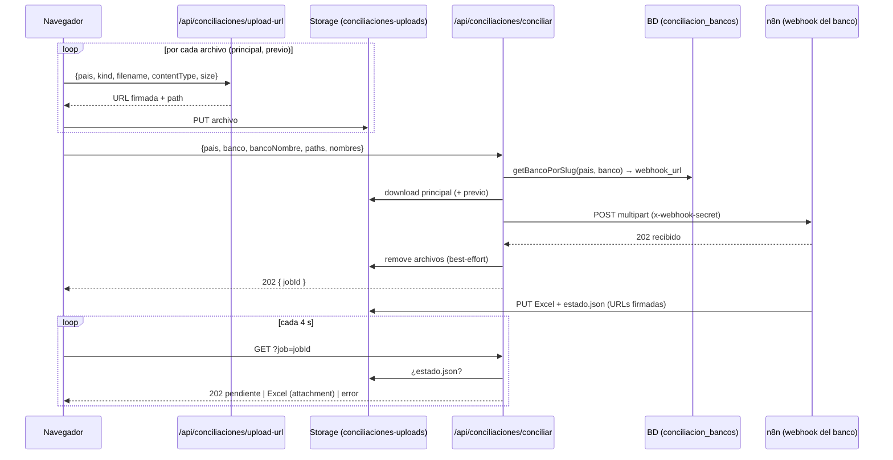

# Conciliaciones bancarias por país

## Qué hace

Permite al equipo contable **conciliar el extracto bancario de un período** (y opcionalmente el reporte previo) para un banco de un país. El portal no concilia nada por sí mismo: sube los archivos, ejecuta el **workflow de n8n configurado para ese banco** y entrega al usuario el Excel que n8n devuelve.

| País | Ruta | Estado |
|---|---|---|
| Colombia (`CO`) | `/conciliaciones/colombia` | Implementado |
| Uruguay (`UY`) | `/conciliaciones/uruguay` | Implementado |
| Ecuador (`EC`) | `/conciliaciones/ecuador` | Implementado |
| Chile (`CL`) | `/conciliaciones/chile` | Solo placeholder |
| México (`MX`) | `/conciliaciones/mexico` | Implementado (particularidades por banco) |

Las páginas implementadas usan el mismo componente `ConciliacionesPageClient`. Algunos bancos tienen **particularidades** que agregan pasos a la UI (ver más abajo).

## Acceso

Un proceso por país (`conciliaciones.colombia`, `conciliaciones.mexico`…). La página llama a `requireAcceso` y devuelve 404 sin acceso; las tres APIs (`upload-url`, `conciliar`, `convertir-txt`) resuelven el proceso con el `pais` del body y exigen nivel `usar`. Con `ver` se ven los bancos pero el botón de procesar queda deshabilitado.

## Flujo del usuario

1. Elige el **banco** (combobox; lista desde BD, solo bancos activos del país). Cambiar de banco limpia el resultado. Debajo aparece el **periodo vigente** del banco ("Conciliando noviembre 2026 hasta el 3 de diciembre") y, con nivel `usar`, el botón **Cambiar periodo** (ver [Periodo por banco](#periodo-por-banco)).
2. Sube el **Extracto bancario** (obligatorio) y, si la tiene, la **Conciliación anterior (Excel de contadores)** (opcional). El extracto acepta `.xlsx`, `.xls`, `.csv`; la conciliación anterior solo `.xlsx` (se valida al elegirla y antes de enviar). Máx. 10 MB c/u.
3. Pulsa **Procesar conciliación**. Se ve el estado "Procesando…" mientras n8n trabaja en segundo plano (la página consulta el resultado cada 4 s).
4. Al terminar, aparece **Descargar** con el Excel resultante. Se puede cancelar quitando el archivo o el banco (aborta las peticiones en curso).

## Flujo técnico

### Paso 1 — `POST /api/conciliaciones/upload-url`

Archivo: `src/app/api/conciliaciones/upload-url/route.ts`

- Requiere sesión (`getClaims`). Valida el cuerpo: `pais`, `kind` (`principal` | `previo`), `filename`, `contentType`, `size`.
- Rechaza tamaño > 10 MB (413) y tipo no soportado (415). Para `kind = previo` solo admite `.xlsx`.
- Genera la ruta `{userId_saneado}/{kind}/{uuid}.{ext}` en el bucket **`conciliaciones-uploads`** y pide una URL firmada con el cliente admin. Devuelve `{url, path, token, bucket, expiresIn: 300}`.

### Paso 2 — Subida directa

El navegador hace `PUT` del archivo a la URL firmada (no pasa por Next).

### Paso 3 — `POST /api/conciliaciones/conciliar`

Archivos: `src/app/api/conciliaciones/conciliar/route.ts`, `src/lib/conciliaciones/conciliar.ts`, `src/lib/conciliaciones/bancos.ts`

La conciliación es **asíncrona**: n8n Cloud corta en 100 s cualquier respuesta de webhook (Cloudflare 524) y un banco con muchos días de NetSuite tarda más.

1. Valida sesión y cuerpo. `maxDuration = 120` s.
2. Comprueba que `storagePathPrincipal` (y `storagePathPrevio`) empiecen por `{userId}/principal/` o `{userId}/previo/` y no contengan más `/`. Si no: 403 `storage_unauthorized`. Si hay previo y su nombre original no es `.xlsx`: 415 `invalid_type`.
3. Busca el banco (`getBancoPorSlug`) en `conciliaciones.bancos` por `pais` + `slug`. Si no existe o `activo = false`: 400 `upstream_config`.
4. `iniciarConciliacion(...)`:
   - Descarga cada archivo del bucket con el cliente admin y los **revalida** (no vacío, ≤ 10 MB, tipo).
   - Crea un `jobId` y dos URLs firmadas de subida en `{userId}/resultado/{jobId}.xlsx` y `.json`.
   - Arma `FormData` (con `resultUploadUrl` y `statusUploadUrl`) y hace `POST` al `webhook_url` con `x-webhook-secret`; espera el **202** de n8n (timeout 60 s).
5. Borra los archivos de entrada y responde `202 { jobId }`.

### Paso 4 — `GET /api/conciliaciones/conciliar?pais=&job=`

El navegador consulta cada 4 s (máx. 15 min). La ruta exige el mismo acceso `usar` del país y arma la ruta del resultado con el usuario de la sesión (nadie lee el de otro).

- Sin `{jobId}.json` todavía: `202 { status: "pending" }`.
- Estado `{ ok: false, error }`: devuelve `{ error, code: "upstream_status" }` (502) con el mensaje de n8n.
- Estado `{ ok: true, fileName, nuevos, existentes, fueraPeriodo }`: devuelve el Excel con `Content-Disposition` y los headers `X-Registros-*`, como antes.
- Al leer el resultado borra los dos archivos; los que queden huérfanos los borra la limpieza diaria del bucket.

## Contrato con n8n

**Request** (`multipart/form-data`), método `POST`, header `x-webhook-secret: <N8N_WEBHOOK_SECRET>`:

| Campo | Tipo | Descripción |
|---|---|---|
| `pais` | texto | `CO`, `UY`, `EC`… |
| `banco` | texto | slug del banco (`conciliacion_bancos.slug`) |
| `bancoNombre` | texto | nombre visible |
| `periodo` | texto | mes que se concilia, `YYYY-MM` |
| `periodoDesde` | texto | primer día del mes, `YYYY-MM-DD` |
| `periodoHasta` | texto | último día del mes, `YYYY-MM-DD` |
| `periodoCierre` | texto | fecha de cierre configurada, `YYYY-MM-DD` (solo si hay una vigente) |
| `file` | archivo | extracto bancario (obligatorio) |
| `previous` | archivo | conciliación anterior de los contadores, `.xlsx` (opcional; solo si se subió) |
| `resultUploadUrl` | texto | URL firmada de Supabase donde n8n sube el Excel (`PUT`) |
| `statusUploadUrl` | texto | URL firmada donde n8n sube el estado JSON (`PUT`, `application/octet-stream` porque el bucket no admite `application/json`) |

**Response:** `202 { ok, executionId }` en cuanto n8n recibe los archivos (nodo *Responder recibido*). Al terminar, n8n sube el Excel (*Subir Excel*) y luego el estado `{ ok: true, fileName, nuevos, existentes, fueraPeriodo }` (*Subir estado*). Si falla cualquier nodo del orquestador (salida de error → *Subir error*), sube `{ ok: false, error }`.

Sin `resultUploadUrl` el flujo sigue siendo síncrono (responde el Excel con headers `X-Registros-*`, o `500 { error }`); se dejó por compatibilidad durante el despliegue.

> Todos los bancos apuntan al mismo webhook (`/webhook/reconciliation`). **n8n elige el adapter del banco según el campo `banco` (slug)**, por configuración en n8n; la lógica de conciliación vive allí, no en este repo. Un banco nuevo solo necesita su fila en `conciliaciones.bancos` con un slug que coincida con su adapter.

## Datos

Tabla `conciliaciones.bancos` (esquema desde `types/supabase.ts`):

| Columna | Descripción |
|---|---|
| `id` | UUID |
| `pais` | `CO`, `UY`, `EC`, … |
| `slug` | Identificador del banco dentro del país |
| `nombre` | Nombre visible |
| `descripcion` | Texto bajo el combobox |
| `webhook_url` | **URL completa del webhook n8n** de ese banco |
| `es_particular` | Marca el banco como caso particular; la UI muestra una insignia |
| `activo` | Si está habilitado |
| `orden` | Orden de aparición |

Lectura de la lista (`getBancosPorPais`): cliente admin, solo activos, ordenados por `orden` y `nombre`, **sin exponer `webhook_url`**, cacheada 60 s (`conciliacion-bancos`).

### Cómo agregar o cambiar un banco

Insertar o editar una fila en `conciliaciones.bancos` (`pais`, `slug`, `nombre`, `webhook_url`, `activo = true`, `orden`). No requiere despliegue; aparece en la UI en ≤ 60 s por la caché. Para desactivarlo: `activo = false`.

## Periodo por banco

Los contadores definen en el portal, **por banco**, el mes que concilian y hasta qué día se sigue trabajando ese mes por el cierre (p. ej. noviembre hasta el 3 de diciembre). Solo cuentan los registros con fecha dentro del mes del periodo; los de otros meses (p. ej. octubre en un extracto de noviembre) se descartan **en n8n**.

- **Dónde se configura:** sección "Banco a conciliar" → **Cambiar periodo** (nivel `usar` del país). Server action `guardarPeriodoBanco` (`src/lib/conciliaciones/actions.ts`); escribe con el cliente admin e invalida la caché `conciliacion-bancos`.
- **Datos:** columnas `periodo` (primer día del mes), `periodo_cierre`, `periodo_actualizado_por`, `periodo_actualizado_en` en `conciliaciones.bancos` (migración `20261109140000_conciliaciones_periodo_banco.sql`). El cierre no puede ser antes del último día del mes.
- **Regla** (`src/lib/conciliaciones/periodo.ts`, con la fecha de hoy en la zona horaria del país):
  - hoy ≤ `periodo_cierre` → se concilia el mes configurado.
  - pasado el cierre o sin configurar → se concilia el **mes en curso**.
- **n8n:** el servidor (no el navegador) calcula el periodo y lo envía como `periodo`, `periodoDesde`, `periodoHasta` y `periodoCierre` a `/webhook/reconciliation` y a los webhooks de unificación (`banorte-txt-a-excel`, `unificar-extractos`). Cada flujo debe filtrar las filas del extracto con `periodoDesde ≤ fecha ≤ periodoHasta` antes de conciliar y, si quiere, informar las descartadas en `X-Registros-Fuera-Periodo`. La conciliación anterior (`previous`) no se filtra: trae los pendientes de meses previos.
  - En el orquestador `Reconciliation (Webhook)`: **Classify Files** fuerza `overrides.netsuite.desde/hasta` al mes del periodo, así todos los adapters consultan NetSuite solo en ese mes (hasta fin de mes cuando ya pasó; si el mes sigue en curso, cada adapter usa su tope por defecto). **Aplicar periodo** descarta además los registros de NetSuite con fecha contable fuera del mes, salvo los que cruzan por llave con un movimiento del extracto del periodo (p. ej. venta con tarjeta del 30/10 abonada el 03/11).
  - México: los adapters consultan NetSuite **hasta ayer** (como el adapter General), aunque el extracto llegue a una fecha anterior; lo posterior al extracto sale como *Solo en NetSuite*. Banorte ubica el extracto en el periodo por **Fecha Abono** y consulta NetSuite desde la *Fecha Transacción* más antigua de esos abonos (máx. 10 días antes del mes), porque NetSuite registra la venta en la fecha de transacción.
  - Excel: la columna **G = Cuenta** (cuenta contable del banco en NetSuite) va antes de *ID Interno*. Un archivo anterior con el layout viejo (G = ID Interno) se sigue actualizando con su layout, sin la columna.

## Particularidades por banco

Se declaran en `src/lib/conciliaciones/particularidades.ts` (clave `PAIS:slug`).

### Conversión TXT → Excel (México · Banorte)

Banorte entrega el extracto en uno o varios `.txt`. Con el banco `bananorte-mexico`, dentro de **Archivos a conciliar** aparece una línea discreta: "¿El extracto viene en uno o varios .txt? Convertir a Excel" (opcional). La conciliación queda en dos pasos:

1. **Paso 1 — conversión.** El usuario elige uno o varios `.txt` (input `multiple`; hasta 31 archivos y 4 MB en total, porque van directo en el cuerpo, sin Storage). `POST /api/conciliaciones/convertir-txt` (multipart: `pais`, `banco`, `files[]`) los reenvía a `/webhook/banorte-txt-a-excel` como `file_0`, `file_1`, … con `x-webhook-secret`; timeout 120 s.
   - **OK:** n8n devuelve un `.xlsx` consolidado y los headers `X-Archivos`, `X-Registros`, `X-Total-Neto`, `X-Alertas`, `X-Errores`, `X-Duplicados-Omitidos` y `X-Archivos-Error` (`[{archivo, error}]` con `encodeURIComponent`). La ruta los reenvía y la UI muestra el resumen y la lista de TXT que no se pudieron leer. El Excel se carga como **Extracto bancario** con el nombre `banorte_extracto.xlsx` y se puede descargar.
   - **Error:** el cuerpo es JSON `{ error, archivosConError[] }`; la UI muestra "Falló el paso 1 (conversión de TXT)" con el detalle por archivo.
2. **Paso 2 — conciliación.** Es el flujo normal (**Procesar conciliación** → `/webhook/reconciliation` con `banco=bananorte-mexico`, `file=banorte_extracto.xlsx` y `previous` si se subió). El botón muestra "Paso 2 de 2 · Conciliando…" y, si falla, "Falló el paso 2 (conciliación)". Timeout de 280 s (la función tiene `maxDuration = 300`).

La configuración está en `src/lib/conciliaciones/particularidades.ts` (bancos con TXT y nombre del Excel) y la URL del webhook en `src/lib/conciliaciones/convertir-txt.ts` (solo servidor).

### Unificar reportes diarios en Excel (México · resto de bancos)

Los demás bancos de México entregan un reporte por día. Con cualquier banco `MX` distinto de `bananorte-mexico` aparece la línea "¿Tienes varios reportes diarios en Excel? Unificar en un Excel" (opcional). Es el mismo flujo de dos pasos que Banorte, pero con `.xlsx`/`.xls`:

1. **Paso 1 — unificación.** Misma ruta `POST /api/conciliaciones/convertir-txt` y mismos límites (31 archivos, 4 MB en total). Se reenvía a `/webhook/unificar-extractos` como `file_0`, `file_1`, … con `pais` y `banco`; se espera la misma respuesta (`.xlsx` + headers `X-*`, o JSON `{ error, archivosConError[] }`). El Excel unificado se carga como extracto con el nombre `<slug>_extracto.xlsx`.
2. **Paso 2 — conciliación.** Igual que arriba, con el Excel unificado.

La regla por país está en `PAISES_UNIFICAR_EXCEL` (`particularidades.ts`) y la URL en `WEBHOOKS_UNIFICAR_EXCEL` (`convertir-txt.ts`). Un banco con conversión propia en `BANCOS_CON_CONVERSION` tiene prioridad.

## Errores

| Código | HTTP | Mensaje al usuario |
|---|---|---|
| `unauthorized` | 401 | Tu sesión expiró |
| `bad_request` / `missing_file` | 400 | Solicitud inválida / falta el archivo principal |
| `invalid_type` | 415 | Usa .xlsx, .xls o .csv |
| `file_too_large` | 413 | Supera 10 MB |
| `storage_unauthorized` | 403 | No tienes acceso a este archivo |
| `storage_not_found` | 404 | El archivo ya no está disponible, súbelo de nuevo |
| `upstream_config` | 400/500 | Banco sin regla/webhook configurado |
| `upstream_timeout` | 504 | La conciliación tardó demasiado |
| `upstream_network` | 502 | No se pudo contactar a n8n |
| `upstream_status` | = estado de n8n | n8n devolvió error (≥ 500: "servicio no disponible") |
| `upstream_empty` | 502 | n8n devolvió un archivo vacío |
| `internal` | 500 | Error inesperado |

## Archivos fuente

- Páginas: `src/app/(app)/conciliaciones/{colombia,uruguay,ecuador,mexico}/page.tsx`
- UI: `src/components/conciliaciones/` (`conciliaciones-page`, `bank-combobox`, `dual-upload-card`, `file-slot`, `txt-convert-row`, `types`)
- API: `src/app/api/conciliaciones/{upload-url,conciliar,convertir-txt}/route.ts`
- Lógica: `src/lib/conciliaciones/{conciliar,bancos,particularidades,convertir-txt}.ts`

## Hallazgos

1. **Autorización solo en la página**: las dos API validan sesión pero no que el usuario tenga el rol/país. Alguien autenticado podría llamar `/api/conciliaciones/conciliar` para un país que no tiene asignado.
2. `pais` no se valida contra la lista de países conocidos.
3. Nombre `conciliarColombia` confuso: es genérico.
4. No hay historial de conciliaciones; el resultado se pierde al recargar.
5. Chile está en el menú pero sin implementación.
6. La caché de bancos no se invalida manualmente (no hay `revalidateTag("conciliacion-bancos")`); depende del TTL de 60 s.
