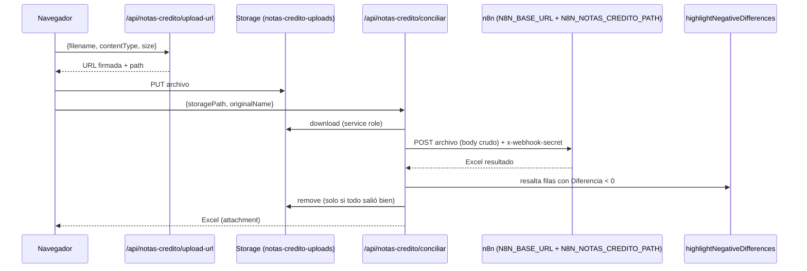

# Notas crédito (conciliación contra NetSuite)

## Qué hace

El usuario sube un archivo de notas crédito; el portal lo envía a un **workflow de n8n** (cuyo webhook se llama por defecto `conciliacion-netsuite`) que lo concilia y devuelve un Excel. Antes de entregarlo, el portal **resalta en rojo las filas con diferencia negativa** y lo ofrece para descarga.

## Acceso

Ruta `/ingresos/notas-credito`, área **Ingresos**, proceso `ingresos.notas-credito`. La página exige acceso (`requireAcceso`) y las dos APIs exigen nivel `usar`; con `ver` la página muestra el aviso de solo lectura en lugar de la carga.

## Flujo del usuario

1. Arrastra o selecciona un archivo `.xlsx`, `.xls` o `.csv` (máx. 10 MB).
2. Pulsa procesar. Estados: `uploading → processing → done | error`.
3. Descarga el resultado. Debajo hay una lista de **historial de ejecuciones de la sesión** (`HistoryList`) con opción de volver a descargar.

El historial vive en `useState` del navegador: **se pierde al recargar**.

## Flujo técnico

### `POST /api/notas-credito/upload-url`

`src/app/api/notas-credito/upload-url/route.ts`

Igual que en conciliaciones, con estas diferencias: un solo archivo, bucket **`notas-credito-uploads`**, ruta `{userId}/{uuid}.{ext}` (el `userId` **no** se sanea) y URL de 5 min.

### `POST /api/notas-credito/conciliar`

`src/app/api/notas-credito/conciliar/route.ts` · `maxDuration = 60`

1. Valida sesión y cuerpo (`storagePath`, `originalName`).
2. Comprueba con regex que la ruta sea `^{userId}/[^/]+$` (403 si no).
3. Descarga el archivo del bucket (admin). Valida que no esté vacío, ≤ 10 MB y tipo permitido; si falla, lo borra del bucket.
4. `conciliarNotasCredito(file)` (`src/lib/notas-credito/conciliar.ts`):
   - URL = `N8N_BASE_URL` + `N8N_NOTAS_CREDITO_PATH` (por defecto `webhook/conciliacion-netsuite`).
   - `POST` con **el archivo como cuerpo crudo** (no multipart), header `x-webhook-secret`, timeout **60 s**.
   - Lee la respuesta binaria; vacía → error `upstream_empty`.
5. `highlightNegativeDifferences(buffer)` (ver abajo). Si falla, **se entrega el archivo de n8n sin resaltar** y se registra en consola.
6. Borra el archivo subido y responde con el Excel (`Content-Disposition` de n8n; por defecto `resultado_netsuite.xlsx`).

## Contrato con n8n

| | |
|---|---|
| Método / URL | `POST {N8N_BASE_URL}/{N8N_NOTAS_CREDITO_PATH}` |
| Header | `x-webhook-secret: <N8N_WEBHOOK_SECRET>` |
| Body | Contenido binario del archivo subido |
| Respuesta | Excel binario; opcionalmente `Content-Disposition` con el nombre |

La conciliación contra NetSuite ocurre **dentro del workflow de n8n** (no está en el repo).

## Resaltado de diferencias negativas

`src/lib/notas-credito/highlight-differences.ts` (usa `xlsx-populate`):

1. Recorre **todas las hojas** del Excel devuelto.
2. En cada una busca en la **fila 1** una columna cuyo encabezado sea `diferencia` (sin distinguir mayúsculas ni espacios). Si no existe, salta la hoja.
3. Para cada fila siguiente interpreta el valor como número (acepta números, texto numérico, resultados de fórmula).
4. Si es **< 0**, pinta **toda la fila** con fondo `#FEE2E2` y texto `#B91C1C`.
5. Si no hubo filas resaltadas devuelve el archivo original. Si hubo, reescribe el libro y **lo vuelve a abrir para validarlo**; si la validación falla, devuelve el original.

## Errores

Mismos códigos que conciliaciones (`unauthorized`, `bad_request`, `missing_file`, `invalid_type`, `file_too_large`, `storage_unauthorized`, `storage_not_found`, `upstream_config`, `upstream_timeout`, `upstream_network`, `upstream_status`, `upstream_empty`, `internal`). Falta de `N8N_BASE_URL` → `upstream_config`. En errores de n8n la respuesta incluye `storagePath`.

## Variables de entorno

`N8N_BASE_URL`, `N8N_WEBHOOK_SECRET`, `N8N_NOTAS_CREDITO_PATH`, `SUPABASE_SERVICE_ROLE_KEY`, más las públicas de Supabase.

## Archivos fuente

- Página: `src/app/(app)/ingresos/notas-credito/page.tsx`
- UI: `src/components/notas-credito/` (`notas-credito-page`, `upload-card`, `result-card`, `history-list`, `types`)
- API: `src/app/api/notas-credito/{upload-url,conciliar}/route.ts`
- Lógica: `src/lib/notas-credito/{conciliar,highlight-differences}.ts`, `src/lib/uploads.ts`, `src/types/xlsx-populate*.ts`

## Hallazgos

1. **Sin control de rol en servidor** (página y API).
2. **Archivos huérfanos**: cuando n8n falla, el archivo subido **no se borra** del bucket (la respuesta devuelve `storagePath`, pero no hay limpieza programada visible). Conviene una política de expiración en el bucket.
3. El `userId` se usa sin sanear en la ruta y se interpola en una `RegExp` (seguro con UUID, pero frágil). Conciliaciones sí lo sanea.
4. Duplicación de código con conciliaciones (validaciones, `extractFilename`, `buildStorageFilename`, errores).
5. Historial solo en memoria.
